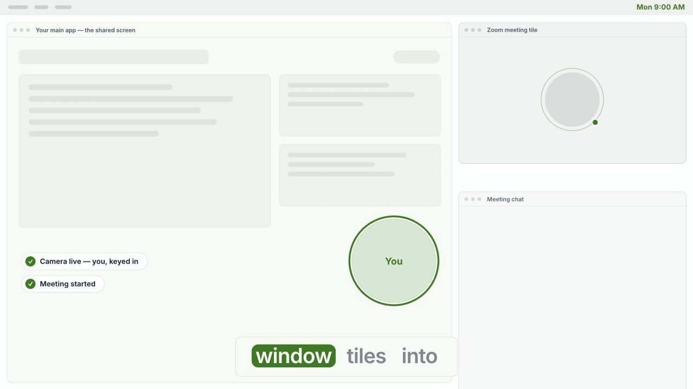

<p align="center">
  <picture>
    <source media="(prefers-color-scheme: dark)" srcset="Branding/greenroom-logo-dark.png">
    
  </picture>
</p>

<p align="center">
  <a href="https://sibhimanyu.github.io/greenroom/#video"></a>
  <br>
  <a href="https://sibhimanyu.github.io/greenroom/#video"><b>&#9654;&#65039; Watch the 37-second intro</b></a>
</p>

# Greenroom

One click sets up your whole morning-meeting workspace:

- **Your screen with your webcam in it**, built by Greenroom itself and
  sent straight into the meeting as your video (a bubble, a green-screen
  or automatic cutout, or the presenter layout) — there is no camera to
  pick in Zoom, and whoever you're talking to sees your screen with you in it.
- **The Zoom meeting**, either created fresh under your account (you host)
  or joined by ID/link — always through Greenroom's own built-in
  Meeting SDK client, no separate Zoom app window.
- **A tiled layout**: your main working app (Chrome by default — any app
  works) on one side of the screen, with the Zoom meeting tile stacked
  over a standalone chat window in the remaining column.

Press **End Session** and it all tears down cleanly.

Around that, for the class itself: **Cues** suggests links for what you
mention while you teach, **Clips** keeps the last five minutes ready to
save, **Sessions** keeps each class's recording, clips, transcript and an
on-device summary, and **Record** keeps a class on your screen with no
meeting at all, with optional timed notes, ready to analyse afterwards.

---

## Installing (from a GitHub release)

1. Grab `Greenroom-x.y.z.zip` from
   [Releases](https://github.com/Sibhimanyu/greenroom/releases) and
   double-click to unzip.
2. **Drag `Greenroom.app` into `/Applications` before launching it.**
   (Launching a freshly downloaded app from `~/Downloads` can trigger
   macOS "app translocation" — a randomized read-only mount that makes the
   first session behave oddly. Moving it first avoids that.)
3. First launch — the app is signed with a development certificate but
   **not notarized**, so macOS blocks the first open:
   - **macOS 15 (Sequoia) and later:** open it once (it gets blocked),
     then System Settings → **Privacy & Security** → scroll down →
     **"Open Anyway"** → confirm. The right-click trick no longer works
     on Sequoia.
   - **macOS 14 and earlier:** right-click the app → **Open** → confirm.

   Either way it's a one-time decision; every later launch is a normal
   double-click.

**Why a `.zip` and not a `.dmg`?** Building a DMG mounts a temporary
volume, and corporate endpoint security (CrowdStrike's data-protection
module, on the machine these releases are built on) treats mounted disk
images like removable media and blocks the unmount — DMG creation dies
mid-pipeline. A `ditto`-made zip is plain file I/O, preserves the code
signature (verified after a round-trip on every release), and unzips to
the same drag-to-Applications experience.

### Requirements

- macOS 14 or later
- macOS 26 for three things only: **Cues**, the **class summary** in
  Sessions (also needs Apple Intelligence on), and **Analyse's written
  feedback on the Mac** when no agent is set up (also needs Apple
  Intelligence on). Everything else, Analyse included, runs on macOS 14+.
- Nothing else to install. Greenroom captures the screen and camera and
  builds the picture itself.

---

## First-run setup

First launch opens a built-in **setup guide** that walks through all of
this interactively, with live detection of what's already done. Reopen it
anytime from the **?** button in the main window. The short version:

1. **Get the Zoom credentials in.** Two paths:
   - **Someone already set this up** (a teammate sent you the app): have
     them export their settings — Settings (⌘,) → **Transfer** →
     *Export Settings…* — and send you the file. Import it in the same
     tab. Done; skip step 3 knowledge entirely. The file carries the
     credentials in **plaintext by design** (it's meant for direct
     hand-off between trusted people, e.g. AirDrop) — delete it after
     importing.
   - **You're setting up from scratch:** you need two free Zoom
     Marketplace apps (one for the chat/meeting client, one for creating
     meetings). Step-by-step instructions live in
     [`Vendor/README.md`](Vendor/README.md).
2. **Grant permissions as macOS asks for them** (the guide tracks each):

   | Permission | When it's asked | What it's for |
   |---|---|---|
   | Camera | First Start | The webcam feed Greenroom composites |
   | Screen Recording | First Start that shares something | Greenroom captures the screen you share and draws it into the class picture (camera only until it is on) |
   | Automation → Google Chrome | First time the Chrome window is tiled | Chrome is positioned via its own AppleScript dictionary |
   | Accessibility | First time a non-Chrome main app is tiled | Moving windows of apps that have no AppleScript dictionary |

   Screen Recording belongs to the class picture: Greenroom captures the
   display, app or window you chose to share (picture only, never system
   sound), for a meeting and for **Record**. Analysing a recording reads a
   file that is already on your Mac, so it needs no screen permission. It
   asks for Speech Recognition (used on-device only) the first time it
   transcribes with Apple's recogniser instead of whisper.

   **One more thing about Analyse, stated here because the rest of this README
   is a list of things that stay on your Mac:** Analyse can hand a recording's
   transcript to a command-line agent you already have (Claude Code, Codex, or
   a command you write). That is the only feature in Greenroom whose destination
   Greenroom does not control. It is off by default, the exact command it
   runs is shown under *How to analyse* beside Analyse, the agent gets
   read-only access to a temporary copy of the session's folder with the
   recording left out, and what a cloud agent then does with a transcript and
   stills of a named student is between you and it. Greenroom does not send the
   audio or video. Everything else in Analyse — transcription, the counts, and
   (with no agent) the written feedback — runs on your Mac.
   See the [how-it-works page](https://sibhimanyu.github.io/greenroom/how-it-works.html#Analyse).

   **Credential storage note:** the Zoom app credentials are kept in
   Greenroom's local preferences (`UserDefaults`) in **plain text** — not
   encrypted (see `App/Zoom/SecretStore.swift`). Greenroom does not use
   the macOS Keychain at all. They never leave your Mac except to Zoom
   itself; the risk is purely local (someone with access to your user
   account could read them).
   See the [how-it-works / safety page](https://sibhimanyu.github.io/greenroom/how-it-works.html).

---

## Daily use

1. Pick **New Meeting** (creates a fresh meeting under your Zoom account,
   you host) or **Join Existing** (paste a link with the **Paste Link**
   button, or type the meeting ID/passcode).
2. Press **Start** (or ⌥⌘G). In order: the picture comes up (screen and camera)
   → the meeting starts/joins → your main app opens tiled to
   its slice → the Zoom tile and chat window fill the side column →
   Greenroom's own window drops to the back and your main app is focused.
3. Work. The chat window is a real chat client for the meeting — no need
   to open Zoom's chat panel over your shared screen.
4. Press **End Session** (main window or menu bar): leaves/ends the
   meeting, closes the chat, finishes any recording, stops the camera and
   screen capture.

Also available:

- **Record** (main window or menu bar) — records exactly what the
  class sees (screen + webcam composite, not other participants)
  into the class folder in `Documents/Greenroom`. Auto-record on Start is
  off by default.
- **Clips** — while a session runs, Greenroom keeps the last 5 minutes in
  memory (on by default: *Keep the last 5 minutes clippable*). **⌥⌘1**,
  **⌥⌘2** or **⌥⌘5** saves the last 1, 2 or 5 minutes into the class
  folder, whether you are recording or not. A clip holds what the class
  saw from you: your composited screen, your webcam and your mic. Not other
  participants, not Zoom audio.
- **Sessions** (its own window) — a card grid with a sidebar to show
  **Classes**, **Recordings** (from Record) or **Presentations** (folders made
  by an earlier version). A session shows its recording, clips, transcript
  (if Cues wrote one), **Analyse**, and YouTube status with Open / Copy link. In the
  Transcript tab, **Summarise on this Mac** writes `summary.md` into the
  class folder with Apple's on-device model, never a cloud call. It needs
  macOS 26 with Apple Intelligence on, and a transcript, so Cues must have
  been on for that class.
- **Menu bar → Snap Windows Back** — re-tiles everything to the session
  layout after you've dragged windows around.
- **Cues** — off by default, macOS 26 only. Turn it on in Settings → Cues
  and it listens to your microphone while the class is live, offering link
  cards for the books, videos, topics, people and places you name. Nothing
  opens by itself: you click **Open** or send the card to the chat.
- **Record** on the home screen — the same class picture with no meeting:
  press Record, teach, press Stop. Turn **Notes** on to type timed notes
  while it records. Nothing is analysed until you ask: open the session in
  Sessions and press **Analyse** (see [Analyse](#analyse) below).
- **Manual controls** (pull-down beside the Status toggle) — each piece of the
  session individually: open just the chat window, just the main-app
  window, or just Zoom.

---

## Settings (⌘,)

### Webcam
How you appear in the composite: **square**, **circle**, **rounded
rectangle**, **cutout**, or **presenter**. Cutout chroma-keys your
background away so you float over the shared screen; Presenter rebuilds
the macOS "Presenter Overlay (Large)" look inside the composite — the
shared screen shrinks into a rounded panel and you stand keyed at full
height in front of it. (Apple's own Presenter Overlay can't be triggered
programmatically and is Apple-silicon-only; this one works on any Mac and
needs no per-meeting toggle.) Both keyed modes need a real green screen
behind you; its strength is fixed, so even, bright light on the green screen
matters most (or leave removal on Automatically). Shape changes apply live.

**Camera switching** (off by default): pick two or more cameras here and
turn it on. An iPhone through Continuity Camera can be the second one.
During a class every chosen camera is open, and Vision compares them: the
class gets whichever camera sees your face most head-on, once it is clearly
better than the live one for the delay you set (1 second by default). It
reads which way your head points, not your eyes, so a camera on top of a
monitor works while you look at that screen. Looking down at the floor, or
away from every camera, switches nothing. Pick a hard cut or a short crossfade; a bar over your self view
fills during the wait, and the class never sees it. The first camera opens
at Start and the others once the meeting is live, so an iPhone is not woken
until the class needs it. It all runs on the Mac, and aiming a camera
needs no session running.

### Layout
The tiled-workspace arrangement, with a live schematic that previews
every change:

- **Main app** — dropdown of every installed and running app, with
  **Greenroom Browser** pinned at the top. Chrome is the default. If the
  chosen app is a browser (anything registered as an `https` handler), an
  **Open website** field appears — that URL opens in the tiled window on
  Start.
  - *Greenroom Browser* is the app's own WebKit window: tabs, back /
    forward / reload, find in page (⌘F), history (⌘Y, kept locally in
    `~/Library/Application Support/Greenroom/browser-history.json`), an
    address bar that also searches and suggests as you type (history
    locally; Google completions only while **Suggest searches as you
    type** is on — that setting is the one request the browser makes on
    its own account), favicons, ⌘-click to open a link in a background
    tab, the usual shortcuts (⌘T, ⌘W, ⌘⇧T reopen closed tab, ⌘L, ⌘R, ⌘P,
    ⌘[ / ⌘], ⌘⌥←/→ or ⌃Tab between tabs, ⌘1–9, ⌘+/−/0), downloads to
    ~/Downloads — tiled by Greenroom directly with no Accessibility or
    Automation permission. Sign-ins persist between sessions, and
    **Reopen last session's tabs on Start** (on by default) brings back
    the tabs from the last run alongside the configured website. **Close
    the browser window when the session ends** (off by default) makes End Session
    close it too — tabs are kept for the next Start. Pick
    Chrome (or any other browser) instead when you need extensions.
- **Main pane width** — one click for ½, ⅔, or ¾ of the screen, or drag the
  divider in the schematic to any width from 35% to 85% — and which **side**
  it sits on. The side column is whatever's left.
- **Side column** — toggles for the **Zoom meeting tile** and the **chat
  window**, plus a handle in the schematic for how much of the column's
  height the Zoom tile takes (the chat gets the rest; a lone occupant takes the whole
  column). Toggle one off and it simply isn't tiled — the window stays
  wherever it is.
- **Open the main app automatically on Start** — the opt-out for the
  one-button flow.

A yellow inline warning appears if you pick a non-Chrome app before
granting Accessibility permission — Chrome is special-cased through its
own AppleScript dictionary (lighter per-app Automation permission), but
every other app can only be moved via the Accessibility API. The warning
has an *Open Settings…* button and clears itself once you flip the
switch.

### Zoom

#### Meeting SDK app
Client ID + Secret of the Meeting SDK Marketplace app (General App →
Features → Embed → Meeting SDK). Powers the built-in meeting client and
the chat window. **Only works in meetings hosted under the same Zoom
account as these credentials** — see limitations below.

#### Server-to-Server OAuth app
Account ID / Client ID / Secret of the Server-to-Server OAuth Marketplace
app — powers "New Meeting". Also here:

- **Your display name** — what you appear as in the built-in client.

### YouTube
Off by default. **After a recording**: Do nothing · Ask whether to upload
· Upload automatically. When on, a finished recording (⌥⌘R stop or End
Session) is uploaded to the connected Google account's channel as
**unlisted** or **private**, resumable in 32 MiB chunks, and the link is
copied to the clipboard. Setup: a Google Cloud project with the YouTube
Data API v3 enabled and an OAuth client of type *Desktop app*; paste its
Client ID / Secret, press **Connect Google account…** (browser sign-in,
PKCE + loopback redirect), done. Scope is `youtube.force-ssl` (upload and
edit own videos; used for uploads and the Sessions window's Rename and
Delete from YouTube); the
refresh token lives in `SecretStore` like the Zoom credentials and is
revoked at Google on **Disconnect**. The Sessions window (formerly
Recordings) keeps each class's YouTube links in its folder's
`session.json`, lets you rename a class (display name; the dated folder
stays), rename the video on YouTube, or delete it there (permanent; the
file on the Mac stays and can be uploaded again). Quota: ~1,600 of 10,000 daily units
per upload, so about six a day. While the Google project is in Testing,
the sign-in expires every seven days until it is published. The OAuth
client ID/secret travel in the settings export; the connected account does
not.

### Cues
> Released in 0.9.0. Every entry point still reads
> `CuesAvailability.isReleased` in `App/Cues/CuesAvailability.swift`, so one
> line puts it back behind the curtain if a class goes badly.

Off by default; macOS 26 only (the tab says so on 14/15, and
`FoundationModels.framework` is weak-linked so the app still launches
there). **Listen during classes and suggest links** starts, once the
meeting is live, an `AVAudioEngine` tap on the default input device
feeding a speech-to-text engine on the Mac: Apple's
`SpeechAnalyzer`/`SpeechTranscriber` (the model asset is downloaded once
from Apple through the system asset service — from this tab, never during
a class), or whisper (`whisper-cpp`, with the model shared with Analyse
and selectable from this tab). Finalised sentences go to a mention detector. **Cue-phrase patterns by
default** ("it's called X", "the word X", a quotation): measured against a
recorded class at 16 lookups, 90% recall, 56% precision. Apple's on-device
`FoundationModels` model is available behind *Also suggest links for things
I mention without naming them* — it catches everything, including things
said with no verbal tell, but the same class produced 264 lookups at 3%
precision, so it is off by default.

Before any request: the phrase must have actually been spoken, a lone word
that is in the Mac's dictionary is dropped unless it was said as a name
(so `Tahoma`, `monospace` and `BookFusion` pass while `roads`, `explain`
and `scarves` do not), and no more than six lookups leave per minute. Mentions matching anyone in the meeting (roster, waiting
room, you) are dropped and logged as skipped. The surviving phrase is looked up, using a fuller search query the model
builds from the surrounding sentence (`monospace` → `monospace font`,
which is the difference between finding nothing and finding the right
page). Wikipedia's title search takes the rich phrase and the bare name at
once; Google Books then Open Library for books; YouTube Data API
`search.list` for videos only with a connected account and **Video links
may use YouTube search** on (otherwise a `youtube.com/results` link that
sends nothing until opened). For a **named product** Cues also guesses
the domain from the name (`Haiku Deck` → haikudeck.com), fetches it and
reads only as far as the `<title>` to confirm the site exists and matches
— a request to that product's own homepage, never a search engine. That
phrase is the only thing derived from speech that leaves the Mac, and
every one is written to the status log and
`~/Library/Logs/Greenroom-session.log` with the host it went to.
The transcript is written to `transcript.txt` in the class folder as each
sentence is finalised (a line per sentence, timed from the session start),
beside the recording and the clips — **Save the transcript with the class**
turns that off, in which case it lives only in the 90-second matching
window and is discarded at End Session. Either way it never leaves the Mac;
the closing log line names the file or the count discarded. Caps: 30
lookups a class, 20 YouTube, 5 cards shown / 8 kept, 10-minute card
lifetime. **Language** picks the transcription locale (`en_IN` is
supported; Tamil is not, as of macOS 26). **Try it** listens for two
minutes and runs the real pipeline: live text, real lookups, real cards. Cards you Open or Send are
recorded in the class folder's `session.json` (`links`) and shown in
Sessions as "Links from class". Engine: `App/Cues/`.

### Analyse
For any session in Sessions: a class, a Record session, a meeting
recording, or a presentation recorded by an earlier version. Nothing is
analysed while you record; press **Analyse** afterwards. Runs on macOS 14+;
only the on-Mac written feedback needs macOS 26.

- **Notes** — the home screen's Notes switch types timed notes into any
  session; each note is stamped at the moment you started typing it. Notes
  can be added afterwards too.
- **Counted on the Mac** (no AI) — pace in words per minute (with a
  gauge), filler words, pauses of 2 s or more, and facing the room (head
  direction via Vision, within 20°).
- **Transcribed on the Mac** — whisper.cpp, or Apple's recogniser pinned to
  on-device (it refuses rather than send audio to Apple). Filler words
  need whisper: Apple's recogniser tidies them out, so with it they show
  "Not counted".
- **Written feedback**, in order of preference: your agent if one is set
  up; otherwise Apple's on-device model (**macOS 26 with Apple Intelligence
  on**); otherwise the counted report and your notes, with no written
  feedback. Each rubric line gets a score and a reason.
- **The report** opens as a dashboard with a save panel for exporting.
  Sessions shows it again with Analysis and Notes tabs, and filler and
  note marks on the scrubber.

Setup is asked once, at the first press of Analyse, in a **How to analyse**
panel, and a small *How to analyse…* link beside Analyse reopens it:

1. **whisper** (for filler counts): one button installs the program and a
   model; the model is shared with Cues.
2. **Your agent** (optional, off by default): *My agent* instead of *This
   Mac* — Claude Code, Codex, or a command of your own, run through your
   login shell. It reads the transcript, your notes, a still every 20
   seconds, the counts, the rubric and the student's name, read-only in the
   session's folder. Audio and video are not sent.

**What can leave the Mac:** only what your agent sends, if you turn one on.
That is the one part of Analyse (and of Greenroom's class tools) whose
destination Greenroom does not control. Everything else stays on the Mac.
Folders made by the earlier presentation window (`presentation.mov`,
`notes.jsonl`) still list, play and analyse, labelled *Presentation*.
Engine: `App/Screenroom/` (the folder keeps its old name).

### Transfer
Export/import every setting above as one JSON file — including the webcam
position you dragged into place, your rubric, and your agent command. Three
things deliberately stay behind: the whisper model's file path (an absolute
path to the exporting Mac; the receiving one picks its own best model), the
connected Google account, and whether onboarding has been seen — the whole point is
setting up a teammate's machine without them ever touching the Zoom
Marketplace. **The export contains the secrets in plaintext**; hand it
over directly and have them delete it after importing.

---

## Known limitations

- **Cross-account joins fail in the built-in client** (Zoom error 63,
  `UnableToJoinExternalMeeting`, confirmed by live test): the Meeting SDK
  can only join meetings hosted under the Zoom account that owns the
  Marketplace app. Greenroom says so and stops; it does not hand the meeting
  to the Zoom app, which cannot receive Greenroom's picture. Ask the host to
  run it from your account, or use New Meeting. Details and why the
  documented fixes were abandoned: [`Vendor/README.md`](Vendor/README.md).
- **"Start New Meeting" hosts under the credential owner's account.**
  Free Zoom accounts can host one meeting at a time, so two people
  sharing one settings file can't both start separate meetings at once.
- Single-display layout: everything tiles on the main screen.

---

## Building from source

```sh
brew install xcodegen
# one-time: put your Apple Developer Team ID in project.yml
#   (settings.base.DEVELOPMENT_TEAM - a free personal team works;
#    set it in project.yml, NOT in Xcode's Signing UI, because
#    `xcodegen generate` overwrites project settings from that file)
xcodegen generate
xcodebuild -project Greenroom.xcodeproj -scheme Greenroom -configuration Debug build
open ~/Library/Developer/Xcode/DerivedData/Greenroom-*/Build/Products/Debug/Greenroom.app
```

One thing the repo does **not** contain: `Vendor/ZoomSDK/` — the
proprietary Zoom Meeting SDK for macOS (~600 MB, not redistributable).
Download it with your own Zoom Marketplace account and copy the zip's
contents in; [`Vendor/README.md`](Vendor/README.md) documents the layout
and the rsync/codesign trap to avoid.

Checking the Cues detector after a change:

```sh
scripts/cues-bench.sh            # the report
scripts/cues-bench.sh --verbose  # every false alarm and miss
```

Scores the word-pattern detector and the link resolver against checked-in
fixtures. No network, no speech model, no microphone, no meeting: the same
input gives the same number every run, in about a second. Run it before and
after any change to the detector, its filters, or the resolver's ranking, and
put both numbers in the commit message. It exists because an unmeasured filter
change shipped once and the next real class produced a single suggestion: a
dictionary entry for the word "happening".

Non-obvious build/runtime notes, learned the hard way:

- **Signing identity must stay stable** across rebuilds (hence the team ID
  in `project.yml`): ad-hoc signing gave every build a fresh identity, so
  Gatekeeper treats each rebuild as a different app. (Credentials are kept
  in plain `UserDefaults` via `App/Zoom/SecretStore.swift` — the app uses
  no Keychain, so there's no keychain prompt to worry about either way.)
- **The Zoom SDK's real API names differ from its docs** in several places
  (`ZoomSDK.shared()` not `.sharedSDK()`, chat on
  `ZoomSDKMeetingChatController`, mute flags `isNoVideo`/`isNoAudio`, …)
  — the code was written against the real headers; trust it over the docs.
- **Window management is two-tiered by design**
  (`App/Layout/MainPaneManager.swift` routes): Chrome via its AppleScript
  dictionary (more reliable, handles the URL, per-app Automation
  permission), everything else via the Accessibility API
  (`App/Layout/AppWindowManager.swift`). The layout math lives in
  `App/Layout/WorkspaceLayout.swift`.

## Cutting a release

The setup and compact Settings improvements are included on `main` for the
next release. Its draft notes are in [docs/release/next.md](docs/release/next.md).
Verify the Release build and pass the completed notes file to
`scripts/release.sh <version> <notes-file>` when cutting the release.

```sh
xcodebuild -project Greenroom.xcodeproj -scheme Greenroom -configuration Release build
cd ~/Library/Developer/Xcode/DerivedData/Greenroom-*/Build/Products/Release
ditto -c -k --sequesterRsrc --keepParent Greenroom.app Greenroom-x.y.z.zip
gh release create vx.y.z Greenroom-x.y.z.zip --title "Greenroom x.y.z" --notes-file notes.md
```

Use `ditto` (not `zip`) so the code signature survives; verify with
`ditto -x -k` + `codesign --verify --deep --strict` before uploading.
Don't bother with a DMG on a corporate-managed Mac — see the install
section for why.
